<div align="center">

# swaydesk

**Un escritorio completo para Arch Linux + sway, escrito en Go.**

Lanzador de aplicaciones, panel de control, portapapeles, barra de estado, temas
adaptativos, fondos animados (GIF y *live wallpapers*) y sesión — todo en
**siete binarios estáticos**, sin dependencias externas de Go y sin un solo
script de shell.

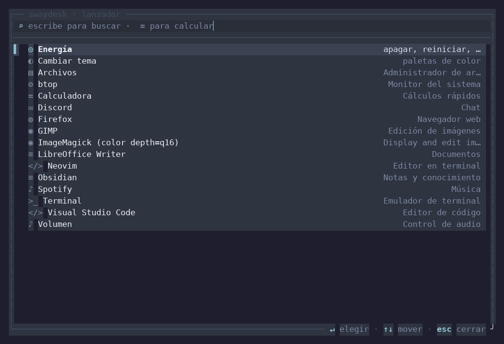

**[github.com/ShadowNigth/Jonatan-1999](https://github.com/ShadowNigth/Jonatan-1999)** ·
`git clone https://github.com/ShadowNigth/Jonatan-1999.git`

</div>

---

## ¿Qué es esto?

`swaydesk` convierte una instalación mínima de **Arch Linux + sway** en un
escritorio utilizable y agradable sin arrastrar medio GNOME. Está escrito
íntegramente en Go (solo biblioteca estándar) e incluye su propio toolkit de
interfaz para terminal: no usa ncurses, ni Bubble Tea, ni ningún módulo de
terceros.

| Binario | Qué hace |
|---|---|
| `swaymenu` | Lanzador de aplicaciones con búsqueda difusa, historial de uso, calculadora y acciones del escritorio |
| `swayctl` | Panel de control: estado del sistema, workspaces, ventanas, temas y chuleta de atajos |
| `swayclip` | Historial del portapapeles (cliphist / clipman) con búsqueda y vista previa |
| `swaydesk` | CLI central: instala la configuración, aplica temas, diagnostica, controla la sesión |
| `swaybar` | Barra de estado propia dibujada en píxeles sobre `wlr-layer-shell` (sustituye a waybar) |
| `swaynotify` | Daemon de notificaciones: habla `org.freedesktop.Notifications` por D-Bus y dibuja las tarjetas en píxeles (sustituye a mako) |
| `swayosd` | Avisos en pantalla: el nivel de volumen aparece unos instantes en una tarjeta flotante con fundido |

```
╭── swaydesk · lanzador ─────────────────────────────────────────────╮
│ ⌕ fire                                                             │
│────────────────────────────────────────────────────────────────────│
│▌ ◍ Chromium                                        Navegador web    │
│  ◍ Firejail                          Ejecuta apps en una jaula      │
│                                                                     │
╰──────────────────────────── ↵ elegir · ↑↓ mover · esc cerrar ──────╯
```

## Características

- **Lanzador inteligente**: busca en aplicaciones `.desktop`, comandos del
  `PATH`, acciones integradas y calculadora (`=128*3`). Ordena por
  *frecuencia + recencia* (algoritmo de frecency), igual que `z` o `fzf`.
- **Búsqueda difusa** propia con puntuación por límites de palabra, prefijos y
  coincidencias consecutivas. Todo en Go, sin dependencias.
- **Panel de control** (`Super+i`): estado de sway y del sistema con barras,
  lista de ventanas con acciones (enfocar, cerrar, flotar, pantalla completa),
  cambio de tema en vivo y chuleta de atajos.
- **Portapapeles** con soporte de `cliphist`, `clipman` o `wl-paste`, búsqueda,
  vista previa y borrado de entradas.
- **31 paletas de color**, 21 de ellas con estética **anime** (Sakura, Miku, Asuka, Rei,
  Zero Two, Neon Tokyo, Cyberpunk, Vaporwave, Ghibli, Hoshizora, Oni, Mecha…),
  además de las clásicas (Catppuccin, Tokyo Night, Nord, Gruvbox, Dracula,
  Kanagawa, Rosé Pine, Everforest), aplicadas de forma coherente a sway,
  waybar, foot, mako, swaylock y a las propias TUI.
- **Galería de temas** (`Super+t`): selector a pantalla completa con vista
  previa real del tema — degradados, muestras de color, ventana de ejemplo y
  fondo animado — filtro difuso y navegación por categorías.
- **Temas adaptativos**: `swaydesk theme --from-wallpaper` extrae los colores
  dominantes de tu fondo (cuantización + HSL + contraste WCAG) y genera una
  paleta completa que se guarda en `~/.config/swaydesk/themes/`.
- **Fondos animados de verdad**: 11 escenas procedurales (pétalos de sakura,
  nieve, estrellas, lluvia de neón, aurora, olas, ciudad cyberpunk, brasas,
  rejilla synthwave, pradera, burbujas) y reproducción de **GIF animados**,
  **imágenes** y **vídeos** (`mp4`, `webm`, `mkv` — incluidos los de Wallpaper
  Engine) con un demonio propio que dibuja en una capa
  `wlr-layer-shell` detrás de las ventanas. Cliente Wayland implementado a mano,
  sin librerías.
- **Selector de fondos** (`Super+Shift+w`): galería con vista previa animada en
  vivo, metadatos (duración, tamaño, tipo) y exploración de tus carpetas.
- **Barra de estado propia** (`swaybar`): islas redondeadas y translúcidas
  dibujadas píxel a píxel — sin GTK, Qt ni Cairo. Workspaces con la ventana
  enfocada, título, CPU, RAM, volumen, red, batería, reproductor y reloj;
  tipografía de mapa de bits con fuentes PSF del sistema e iconos siempre
  visibles; se adapta sola a la paleta activa, se refresca al instante con los
  eventos de sway y se configura entera desde `[bar]` en `config.toml`.
- **Notificaciones propias** (`swaynotify`): daemon completo de
  `org.freedesktop.Notifications` sobre un cliente **D-Bus escrito desde cero**
  (SASL EXTERNAL, formato binario con firmas, llamadas, señales y errores), y
  tarjetas dibujadas en píxeles sobre una capa overlay. Urgencias con color,
  acciones, barra de progreso, caducidad con cuenta atrás, modo «no molestar»,
  historial persistente y clic para cerrar o para pulsar una acción. Sin mako.
- **Notificaciones agrupadas**: los avisos de la misma aplicación se apilan en
  una sola tarjeta con contador, capas detrás y la vista previa del último
  mensaje («Marta · y 2 más»). Un clic la despliega en la franja del grupo más
  una tarjeta por aviso; el clic derecho cierra la pila entera. Respeta la
  etiqueta de pila de cada cliente (`x-dunst-stack-tag`, `x-kde-group-id`), así
  que varios chats de la misma app no se mezclan. Se enciende o apaga con
  `group` en `[notify]` (y con `g` en el centro).
- **Imágenes en las tarjetas**: las apps que mandan `image-data` (el hint
  estándar de reproductores, clientes de chat y `notify-send -i`) o `image-path`
  muestran una **miniatura cuadrada** a la izquierda del texto, recortada por el
  centro y con las esquinas redondeadas; el texto se recoloca solo. El
  decodificador PNG/JPEG está escrito desde cero en el proyecto y limita el
  tamaño (512 px de lado y 8 MiB) para que una carátula enorme no congele la
  sesión. `swaynotify send --image ~/portada.png` lo prueba en un segundo.
- **Respuesta rápida y centro de notificaciones**: las apps que hablan
  `inline-reply` (Telegram, Signal, Discord…) muestran el botón **Responder**;
  el texto se escribe en una ventana flotante y vuelve a la app solo a ella
  (`NotificationReplied` en *unicast*). El centro (`Super+n` o clic en la
  pastilla de la barra) lista lo que hay en pantalla y el historial, con filtro
  incremental —sin distinguir mayúsculas ni acentos— y acciones por teclado.
- **Un fondo por workspace**: cada workspace puede tener su propia escena,
  imagen, GIF o vídeo (`[wallpaper.workspaces]`), con el fondo global como
  reserva. El demonio escucha los eventos de sway y cambia al vuelo con
  **transición animada** —fundido, deslizamiento, barrido o zoom, de 0 a 5 s—,
  congelando el fotograma anterior y fundiéndolo con el nuevo fondo en marcha.
- **Animación de arranque** (`Super+Shift+b`): logotipo con degradado, pétalos
  o lluvia de neón, lista de componentes que se activan en vivo y barra de
  progreso. Cuatro estilos (`sakura`, `neon`, `matrix`, `minimal`), duración
  configurable y se salta con cualquier tecla.
- **Translucidez en todo el escritorio**: opacidad configurable para terminal,
  barra, notificaciones, ventanas activas e inactivas, reglas `for_window` para
  decenas de aplicaciones y desenfoque/esquinas cuando el compositor es swayfx.
- **Generador de configuración**: `swaydesk init` escribe una configuración
  completa y comentada de sway, waybar, foot, mako y swaylock, adaptada a tu
  hardware, tu terminal y tu fuente (detecta Nerd Fonts automáticamente).
- **Clipe IPC de sway implementado desde cero** (protocolo `i3-ipc`), con
  soporte de eventos, árbol de contenedores y comandos. Sin `swaymsg` como
  dependencia obligatoria.
- **Iconos adaptativos**: usa Nerd Font si la tienes; si no, cae a símbolos
  Unicode que DejaVu/Noto sí dibujan (nada de cuadraditos).
- **Cero dependencias**: `go build` y listo. Binarios estáticos de ~3 MB.

## Capturas

| Panel de control | Portapapeles |
|---|---|
| 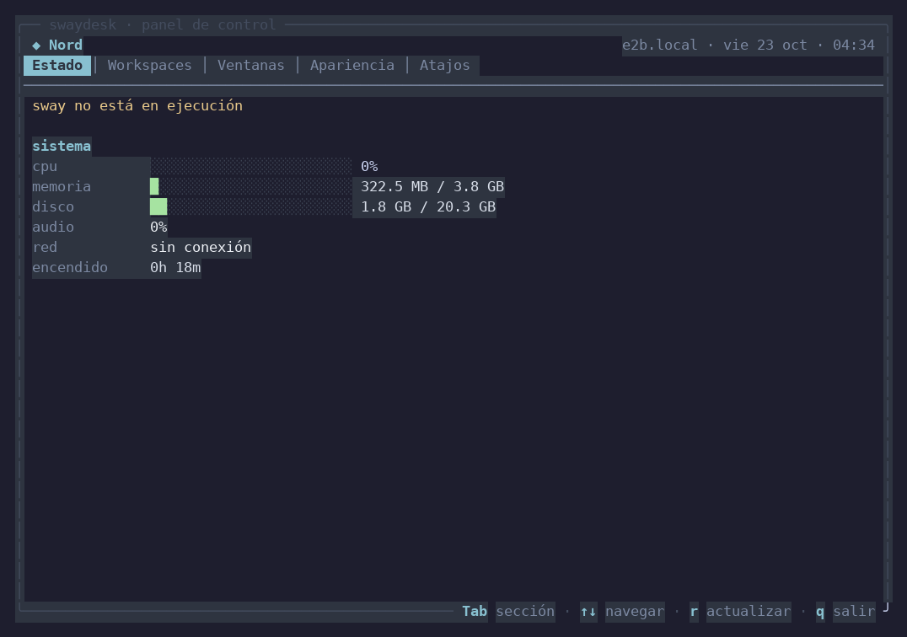 | 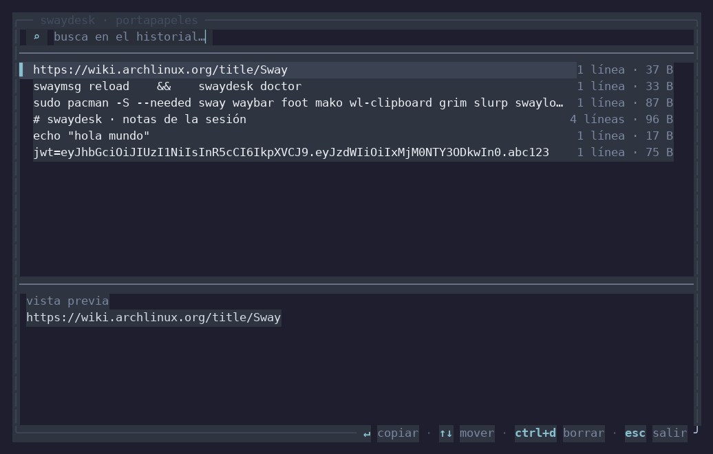 |

| Barra de estado propia | Animación de arranque |
|---|---|
| 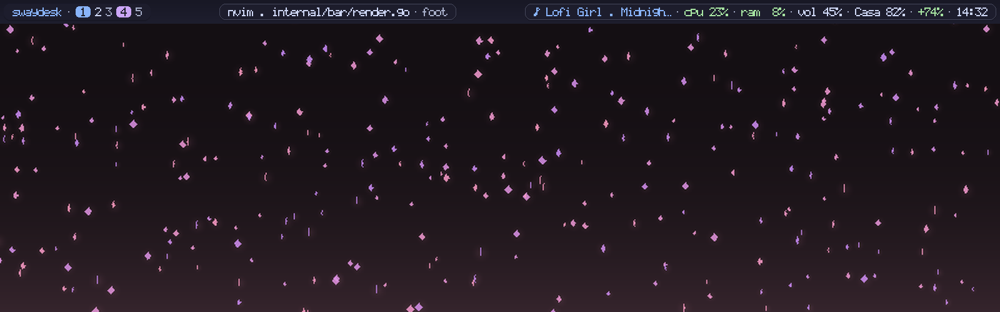 | 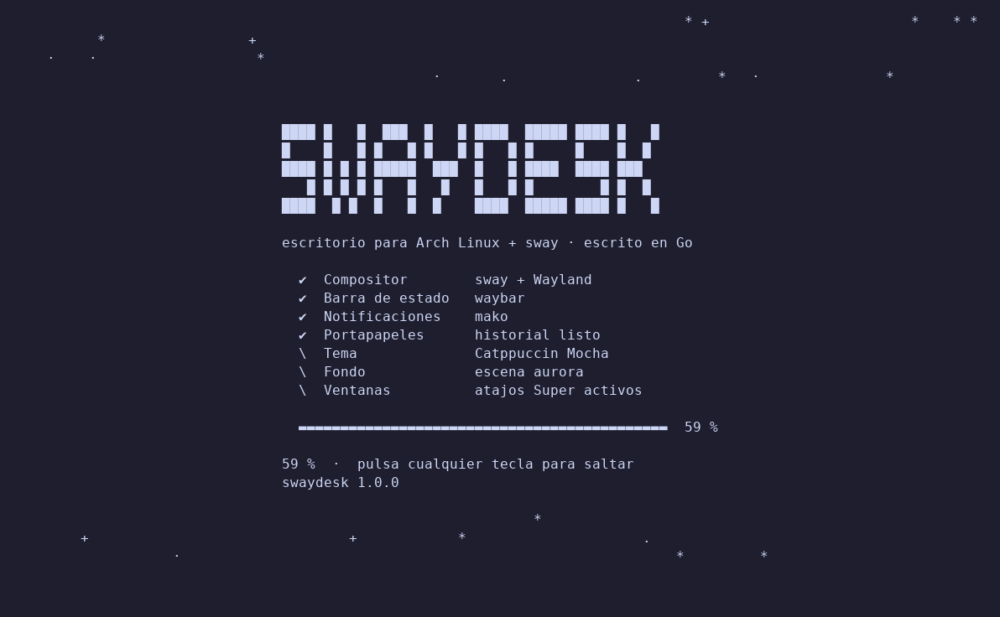 |

| Notificaciones propias | Aviso de volumen (OSD) |
|---|---|
| 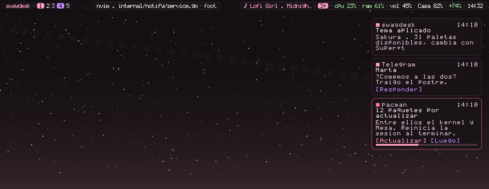 | 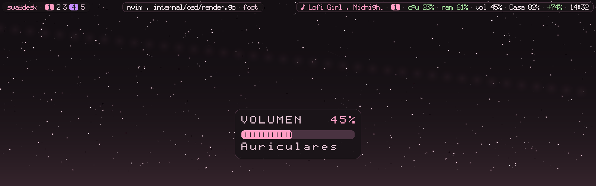 |

| Un fondo por workspace | Transiciones entre fondos |
|---|---|
|  |  |

| Galería de temas (vista previa en vivo) | Selector de fondos animados |
|---|---|
| 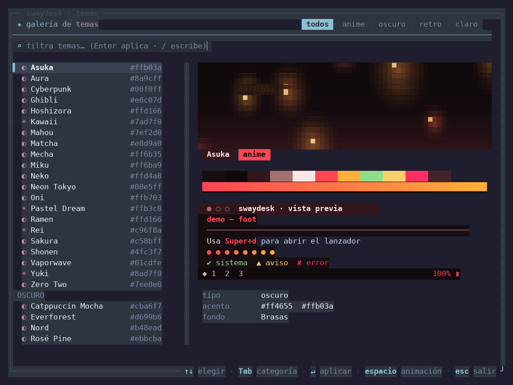 | 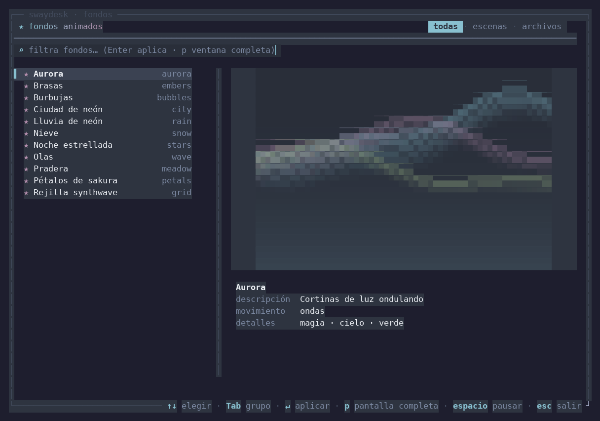 |

| Escenas animadas disponibles | Paletas por categoría |
|---|---|
| 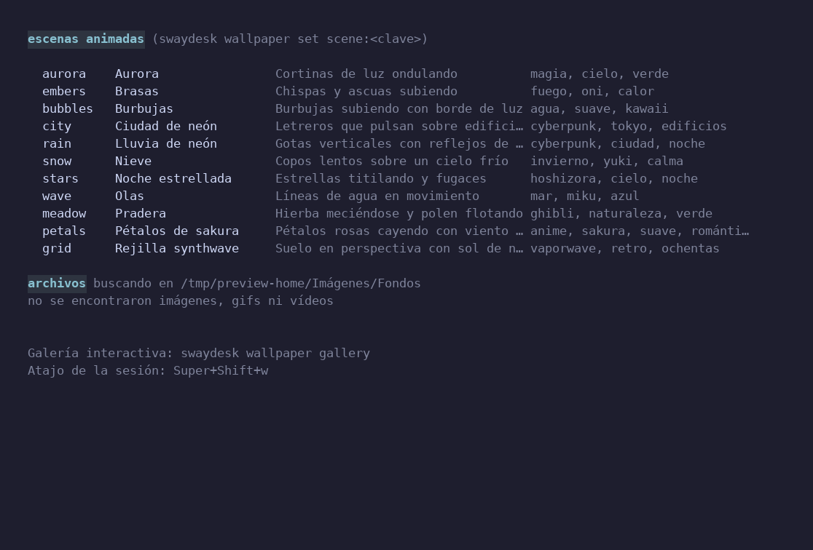 | 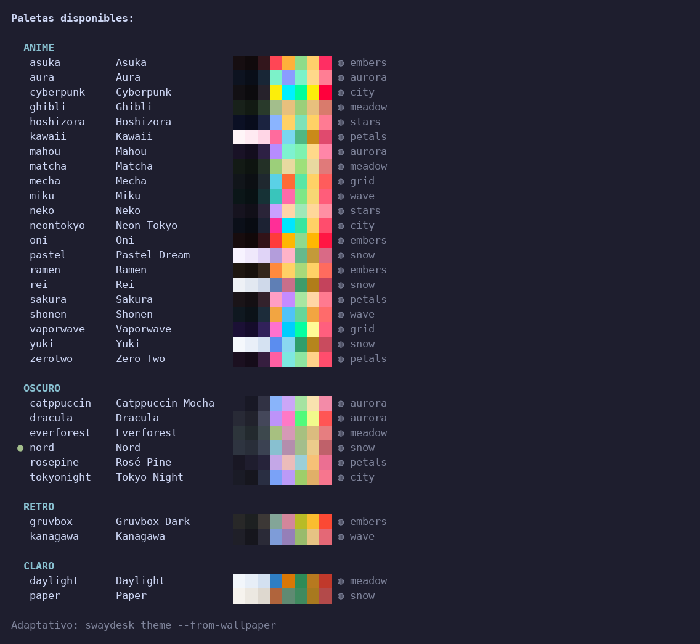 |

| Temas anime | Calculadora |
|---|---|
| 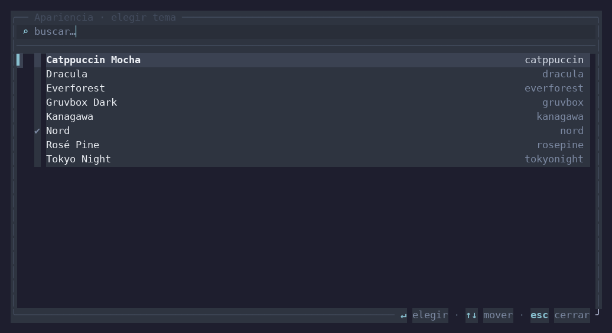 | 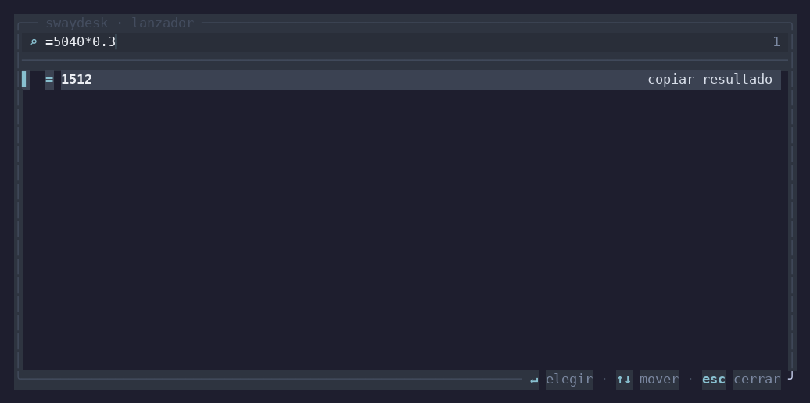 |

| Ventanas | Atajos |
|---|---|
| 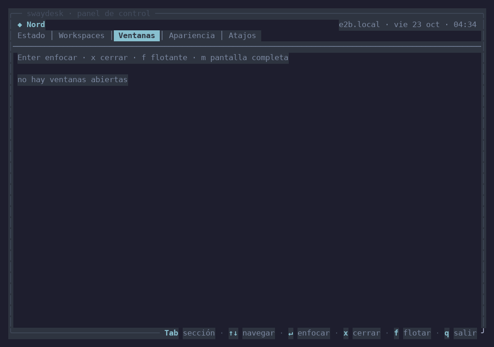 | 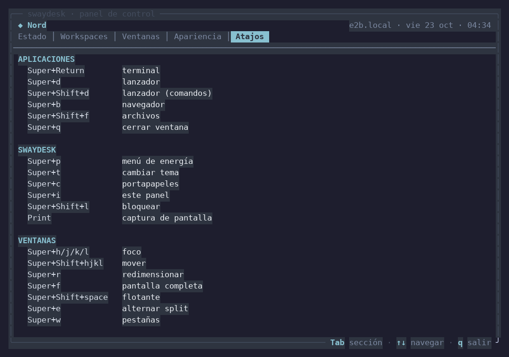 |

---

## Instalación en Arch Linux

### Opción 1: instalador automático (recomendado)

Clona el repositorio y ejecuta el instalador, que compila los siete binarios,
los instala en `~/.local/bin`, genera la configuración y avisa de lo que falte:

```bash
git clone https://github.com/ShadowNigth/Jonatan-1999.git
cd Jonatan-1999
./scripts/install.sh --deps     # --deps instala las dependencias con pacman
```

O en un solo paso, sin clonar a mano (el instalador se clona a sí mismo en un
directorio temporal y lo borra al terminar):

```bash
curl -fsSL https://raw.githubusercontent.com/ShadowNigth/Jonatan-1999/main/scripts/install.sh \
  | bash -s -- --deps
```

| Opción | Efecto |
| --- | --- |
| `--deps` | instala las dependencias recomendadas con `pacman` |
| `--no-config` | no escribe la configuración del escritorio |
| `--force` | sobrescribe la configuración existente (con copia `*.bak-<fecha>`) |

Variables de entorno: `PREFIX` (destino; por defecto `~/.local`),
`SWAYDESK_REPO` (otra URL de repositorio) y `SWAYDESK_BRANCH` (rama o etiqueta).

```bash
PREFIX=/usr/local sudo -E ./scripts/install.sh   # instalación en el sistema
SWAYDESK_BRANCH=v1.0.0 ./scripts/install.sh      # una versión concreta
```

Si `~/.local/bin` no está en el `PATH`, el script te dice la línea exacta que
hay que añadir al `~/.bashrc`/`~/.zshrc`.

### Opción 2: manual

```bash
sudo pacman -S --needed go sway waybar foot mako wl-clipboard \
                          grim slurp swayidle swaylock cliphist \
                          ttf-jetbrains-mono-nerd
make && make install      # ~/.local/bin
swaydesk init             # escribe ~/.config/{sway,waybar,foot,mako,swaylock,swaydesk}
swaymsg reload            # recarga sway (o cierra y abre sesión)
```

Comprueba el resultado con:

```bash
swaydesk doctor
```

### Actualizar

```bash
cd Jonatan-1999
git pull --ff-only                # o: PREFIX=… SWAYDESK_BRANCH=… para otra rama
./scripts/install.sh --no-config  # reconstruye y reinstala sin tocar la config
```

El instalador conserva tu `~/.config/swaydesk/config.toml` y tus temas salvo que
le pases `--force`; después basta `swaymsg reload` (o reiniciar la sesión) para
que la barra, las notificaciones y el fondo usen los binarios nuevos.

### Desinstalar

```bash
make uninstall            # borra los binarios de ~/.local/bin
rm -rf ~/.config/swaydesk ~/.cache/swaydesk   # config y caché (opcional)
```

### Dependencias

| Obligatorio | Recomendado | Opcional |
|---|---|---|
| `sway`, `go` (solo para compilar) | `waybar`, `foot`, `mako`, `swaylock`, `grim`, `slurp`, `wl-clipboard`, `cliphist`, `swayidle`, `chromium` | `pavucontrol`, `playerctl`, `brightnessctl`, `nm-connection-editor`, `wf-recorder`, `ffmpeg` (vídeos de fondo), `swayfx` (blur y esquinas) |

Ninguna de las recomendadas es necesaria para que `swaydesk` funcione: cada
acción comprueba si su binario existe y se oculta del menú si no está.

---

## Uso

```
swaydesk · escritorio para Arch Linux + sway, escrito en Go

Configuración
  init [--force] [--only sway|waybar|foot|mako]   Escribe la configuración
  apply                     Regenera los archivos del tema y recarga waybar/sway
  theme [nombre]            Lista o cambia la paleta activa
  theme --gallery           Galería interactiva de temas con vista previa
  theme --from-wallpaper    Tema adaptativo a partir del fondo actual
  config                    Rutas y valores actuales

Fondos de pantalla
  wallpaper list [--json]   Escenas animadas y archivos encontrados
  wallpaper set <fondo>     scene:petals · gif:x.gif · image:x.png · video:x.mp4
  wallpaper gallery         Selector interactivo con vista previa animada
  wallpaper daemon|--stop   Demonio de fondo animado (live wallpaper)
  wallpaper play [fondo]    Reproduce el fondo a pantalla completa en la terminal
  wallpaper adaptive [img]  Genera y aplica un tema desde los colores del fondo
  wallpaper mode <modo>     fill · fit · stretch · center · tile
  wallpaper workspaces ...  Un fondo por workspace (list · set · unset · clear)
  wallpaper transition ...  fade · slide · wipe · zoom · none y duración en ms

Sesión
  status [--json] [--module M]   Estado (sway, CPU, RAM, disco, batería…)
  doctor                         Diagnóstico de dependencias y configuración
  notify <título> [cuerpo]       Notificación de escritorio
  volume <up|down|mute>          Volumen (con aviso en pantalla si hay swayosd)
  osd [show|preview|volume …]    Avisos en pantalla: estado, repetir, PNG
  screenshot [region|full]       Captura con grim
  lock | reload | power [acción] Sesión y energía

Notificaciones
  notify <título> [cuerpo]   Envía una notificación (usa swaynotify si está)
  notifications status       Estado del daemon, DND y contadores
  notifications dnd [on|off] Modo «no molestar»
  notifications history      Historial (con --json para scripts)
  notifications clear        Cierra las visibles (--all borra el historial)
  notifications center       Centro interactivo: lista, filtro y respuestas
  notifications reply ID     Responde a una notificación (inline-reply)
  notifications preview      PNG con tarjetas de ejemplo
  notifications test         Tres avisos de prueba (chat, descarga, aviso)

Barra propia
  bar                        Estado de la barra (o `bar status`)
  bar on | off               Usar swaybar o volver a waybar
  bar preview [--width N]    Vista previa en PNG
  bar modules cpu ram clock  Elige los módulos de la derecha
```

### Avisos en pantalla (OSD de volumen)

```bash
swaydesk volume up            # sube y muestra el aviso
swayosd volume down           # lo mismo, sin pasar por swaydesk
swayosd show                  # solo mostrar el volumen actual
swayosd watch                 # vigilar y avisar de cualquier cambio
swaydesk osd                  # configuración y volumen actual
```

El aviso es una tarjeta redondeada sobre las ventanas con la etiqueta
`VOLUMEN`, el porcentaje en grande y una barra segmentada; se va solo con un
fundido. `swaydesk osd preview osd.png` genera la imagen sin sesión gráfica.

### Atajos por defecto

| Atajo | Acción | Atajo | Acción |
|---|---|---|---|
| `Super+Return` | Terminal | `Super+d` | Lanzador |
| `Super+Shift+d` | Lanzador + comandos | `Super+b` | Navegador |
| `Super+i` | Panel de control | `Super+c` | Portapapeles |
| `Super+p` | Menú de energía | `Super+t` | Galería de temas |
| `Super+Shift+t` | Galería de temas | `Super+Shift+w` | Selector de fondos |
| `Super+Shift+l` | Bloquear | `Print` | Captura de pantalla |
| `Super+q` | Cerrar ventana | `Super+f` | Pantalla completa |
| `Super+h/j/k/l` | Foco | `Super+Shift+hjkl` | Mover ventana |
| `Super+r` | Modo redimensionar | `Super+1..0` | Workspaces |
| `Super+Shift+1..0` | Mover al workspace | `Super+Shift+c` | Recargar sway |
| `Super+Shift+b` | Repetir la animación de arranque | `Super+Shift+w` | Selector de fondos |
| `Super+Ctrl+b` | Reiniciar la barra | `Super+Shift+n` | Notificación de prueba |
| `Super+Ctrl+n` | No molestar | `Super+Ctrl+Shift+n` | Cerrar notificaciones |
| `Super+n` | Centro de notificaciones (o clic en la barra) | `Enter` | Responder o cerrar en el centro |

La chuleta completa está en `Super+i` → *Atajos*, y en
[`assets/files/sway/config`](assets/files/sway/config).

### Lanzador

| Tecla | Acción |
|---|---|
| Escribir | Filtro difuso (tolera letras salteadas: `chrm` → Chromium) |
| `=` al principio | Calculadora: `=2^10`, `=sqrt(16)*3`, `=20*1.19` |
| `↑` `↓` / `Ctrl+p` `Ctrl+n` | Mover selección |
| `Enter` | Lanzar / copiar el resultado al portapapeles |
| `Esc` | Borrar filtro, o cerrar |

### Panel de control (`swayctl`)

`Tab` cambia de sección; `↑↓` navega; `Enter` actúa; `q` sale.

- **Estado** — versión de sway, ventana enfocada, workspaces, salidas, CPU, RAM,
  disco, temperatura, batería, audio, red y tiempo encendido.
- **Workspaces** — salta a cualquier workspace, con número de ventanas.
- **Ventanas** — `Enter` enfoca, `x` cierra, `f` alterna flotante,
  `m` pantalla completa, `n` envía al scratchpad.
- **Apariencia** — aplica cualquiera de las 8 paletas al escritorio completo.
- **Atajos** — referencia rápida de todos los binds.

### Barra de estado (`swaybar`)

La barra es un único proceso que se conecta a sway por IPC, se dibuja en
memoria y vuelca los píxeles en una superficie `wlr-layer-shell` con reserva de
espacio. Se redibuja con cada evento de sway (workspaces, título, foco) y cada
segundo para el reloj y las métricas; si no hay cambios no consume CPU apenas.

| Parte | Contenido |
|---|---|
| Izquierda | Logotipo, workspaces (el enfocado resaltado, los ocupados en color), ventanas flotantes |
| Centro | Título de la ventana enfocada y `app_id`, recortado al hueco libre |
| Derecha | Reproductor, notificaciones, CPU, RAM, volumen, red, batería y reloj |

- `panel del tema` — los colores salen de la paleta activa; al cambiar de tema
  la barra se recolorea sola (escucha la señal `SIGUSR2`).
- `módulos` — se eligen con `swaydesk bar modules …` o con `modules = [...]`
  en `[bar]`. Si falta un dato (sin batería, sin red, sin reproductor) el módulo
  desaparece en vez de mostrar un hueco.
- `indicador de notificaciones` — el módulo `notify` es una pastilla con el
  número de avisos en pantalla (con `+` si alguno admite respuesta rápida),
  `dnd` cuando está el modo «no molestar» y `avisos` en gris cuando no hay
  nada. Es la única zona pulsable de la barra: un clic abre el centro de
  notificaciones.
- `recorte inteligente` — si el título no cabe, se acorta por caracteres
  completos; si ni así, se sacrifica primero el reproductor y después la isla
  central, para no solaparse nunca con la derecha.
- `HiDPI` — escala al doble con `--no-hidpi` para desactivarlo.

---

## Configuración

Dos archivos, y solo uno es tuyo:

```
~/.config/swaydesk/config.toml   ← tus ajustes (se conserva al regenerar)
~/.config/sway/config            ← generado por swaydesk init
~/.config/sway/config.d/90-user.conf   ← tus overrides (incluido al final)
```

```toml
[general]
theme = "catppuccin"       # catppuccin, tokyonight, nord, gruvbox, dracula,
                           # kanagawa, rosepine, everforest
nerd_font = true           # false = símbolos Unicode
terminal = "foot"          # foot, kitty, alacritty, wezterm, ghostty, xterm, st
launcher = "swaymenu --float"
editor = "nvim"
file_manager = "thunar"
browser = "chromium"
confirm_power = true

[ui]
font = ""                  # vacío = detección automática
font_size = 11
bar_font_size = 13
width = 72                 # tamaño de la ventana flotante del lanzador
height = 20
border = "rounded"         # rounded, square, double, thick, ascii

[input]
keyboard_layout = "latam"

[wallpaper]
kind = "scene"             # scene · image · gif · video · none
name = "petals"            # escena procedural (ver "swaydesk wallpaper list")
path = ""                  # ruta para image/gif/video
mode = "fill"              # fill · fit · stretch · center · tile
fps = 30
protocol = "auto"          # auto · kitty · sixel · ansi (para la vista en terminal)
adaptive = false           # genera un tema desde los colores del fondo
dir = "~/Imágenes/Fondos"  # carpeta que explora el selector

[notify]
enabled = true             # false = volver a mako
position = "top-right"     # top-right · top-left · bottom-right · bottom-left
width = 360                # ancho de las tarjetas
margin = 14
padding = 14
gap = 8
radius = 14
opacity = 0.94
timeout_ms = 6000          # tiempo en pantalla (normales)
critical_timeout_ms = 0    # 0 = las urgentes no caducan
max_visible = 4            # cuántas se apilan
history = 50               # entradas que se recuerdan
max_lines = 3              # líneas del cuerpo
dnd = false                # arrancar en «no molestar»
group = true               # agrupar por aplicación en pilas desplegables
font = ""                  # fuente PSF (vacío = automática)

[bar]
enabled = true             # false = volver a waybar
position = "top"           # top · bottom
height = 38                # píxeles
margin = 6
padding = 14
gap = 10
radius = 0                 # 0 = pastilla completa
opacity = 0.88             # transparencia de las islas
islands = true             # islas separadas o barra continua
logo = true
font = ""                  # fuente PSF (vacío = automática)
shadow = true
exclusive = true           # las ventanas no se solapan con la barra
modules = ["media", "notify", "cpu", "ram", "volume", "network", "battery", "clock"]

[boot]
enabled = true             # animación al iniciar sesión
style = "sakura"           # sakura · neon · matrix · minimal
duration_ms = 2600         # 0 = automática
logo = true                # logotipo grande en bloques

[osd]
enabled = true             # aviso flotante con el nivel de volumen
position = "bottom-center" # bottom-right, bottom-left, top-center, center
width = 320                # ancho de la tarjeta
margin = 72                # separación con el borde inferior
padding = 16
radius = 18
opacity = 0.95
timeout_ms = 1400          # cuánto se queda en pantalla
fade_ms = 140              # fundido de entrada y salida (0 = sin animación)
segments = 24              # marcas de la barra de nivel
font = ""                  # fuente PSF (vacío = automática)
font_scale = 0             # 0 = el doble de la barra, para leerse de reojo

[effects]
terminal_opacity = 0.94    # foot
bar_opacity = 0.86         # waybar
active_opacity = 1.00
inactive_opacity = 0.94
blur = false               # solo swayfx
gaps_inner = 6
gaps_outer = 8
rounding = 12              # solo swayfx
```

Cambiar de tema en caliente:

```bash
swaydesk theme gruvbox     # o Super+t / swaymenu --themes
```

Esto reescribe `waybar/style.css`, `foot/foot.ini`, `mako/config`,
`swaylock/config`, los colores de borde de sway (vía IPC) y avisa a waybar con
`SIGUSR2`. Nada se reinicia.

Fondos animados:

```bash
swaydesk wallpaper set scene:petals --live   # escena procedural + demonio
swaydesk wallpaper set ~/Imágenes/lofi.gif --live
swaydesk wallpaper set ~/Vídeos/4k.mp4 --live   # necesita ffmpeg
swaydesk theme --from-wallpaper             # paleta derivada del fondo
```

Más detalles en [`docs/PERSONALIZACION.md`](docs/PERSONALIZACION.md).

---

## Cómo está hecho

```
cmd/
  swaydesk/     CLI: init, apply, theme, status, doctor, notify, volume…
  swaymenu/     lanzador (búsqueda difusa + frecency + calculadora)
  swayctl/      panel de control multi-pestaña
  swayclip/     historial del portapapeles
internal/
  swayipc/      cliente IPC de sway escrito desde cero (protocolo i3-ipc)
  wayland/      cliente Wayland puro: xdg-shell, shm y wlr-layer-shell
  wallpaper/    motor de fondos: escenas, GIF, vídeo, protocolos kitty/sixel
  boot/         animación de arranque (logo, partículas, progreso)
  bar/          barra de estado: lienzo RGBA, islas, módulos y layout
  notify/       notificaciones: modelo, caducidad, DND, historial y tarjetas
  dbus/         cliente y servidor D-Bus (SASL, formato binario, señales)
  font/         fuentes de mapa de bits (PSF1/PSF2 + 5x7 incorporada)
  gallery/      selectores compartidos: galería de temas y de fondos
  adaptive/     paletas derivadas de imágenes (cuantización + HSL + contraste)
  ui/           toolkit TUI: estilos, colores, entrada, paneles, listas, decoración
  host/         métricas del sistema desde /proc y /sys
  launcher/     .desktop, PATH, terminales, historial
  actions/      energía, sesión, capturas, menús
  config/       parser TOML propio + ajustes
  setup/        generador de configuración (plantillas embebidas con embed)
  calc/         evaluador de expresiones
assets/files/   plantillas de sway, waybar, foot, mako, swaylock, .desktop
```

El paquete `ui` implementa lo necesario para una TUI: medición de ancho con
caracteres CJK y emoji, estilos con color de 24 bits que degradan a 256 colores,
lector de teclas con secuencias de escape, paneles con bordes, listas con filtro
difuso y bucle de pantalla alternativa con manejo de `SIGWINCH`.

El paquete `swayipc` habla el protocolo binario de sway (`i3-ipc` + longitud +
tipo + JSON) sobre el socket UNIX: enviar comandos, leer el árbol de
contenedores, listar workspaces/salidas/entradas y suscribirse a eventos.

Detalles de diseño en [`docs/ARQUITECTURA.md`](docs/ARQUITECTURA.md).

## Desarrollo

```bash
make build     # binarios en bin/
make test      # pruebas (incluye un servidor IPC de sway simulado)
make fmt vet   # formato y análisis estático
make dist      # binarios estáticos para amd64 y arm64
```

El proyecto no tiene dependencias: `go.mod` solo declara el módulo. Las pruebas
cubren el protocolo IPC con un servidor de sway simulado, el **protocolo
Wayland** (codificación de mensajes, alineación, secuencias kitty y sixel), el
**motor de fondos** (las 11 escenas, GIF animados, imágenes y vídeos), las
**paletas adaptativas**, el parser TOML, la búsqueda difusa, el cálculo, las
plantillas y el sistema de layout del toolkit.

## Solución de problemas

| Síntoma | Causa / solución |
|---|---|
| `no se encontró el socket de sway` | No estás dentro de una sesión de sway o `SWAYSOCK` no está exportado. Ejecuta `swaydesk doctor`. |
| El lanzador no abre ventana flotante | Falta un terminal soportado (`foot`, `kitty`, `alacritty`…). Revisa `terminal` en `config.toml`. |
| Cuadraditos en la barra | No hay Nerd Font instalada. Instala `ttf-jetbrains-mono-nerd` o pon `nerd_font = false`. |
| Waybar no cambia de color | Comprueba que waybar corre con el `style.css` generado: `pkill -SIGUSR2 waybar`. |
| `swaydesk init` no sobrescribe | Es intencionado: usa `--force` (crea respaldos `.bak-<fecha>`). |
| El fondo animado no aparece | Necesita un compositor con `wlr-layer-shell` (sway lo tiene). Comprueba `swaydesk wallpaper status` y que el demonio esté activo. |
| Un vídeo no se reproduce | Instala `ffmpeg`; sin él los `.mp4`/`.webm` no se pueden decodificar. |
| El teclado escribe mal los símbolos | Ajusta `[input] keyboard_layout` (`latam`, `us`, `es`, `de`…) y recarga sway. |

## Desinstalar

```bash
make uninstall                      # quita los binarios de ~/.local/bin
rm -rf ~/.config/swaydesk           # ajustes
# la configuración generada está en ~/.config/{sway,waybar,foot,mako,swaylock}
```

## Licencia

MIT. Consulta [LICENSE](LICENSE).
