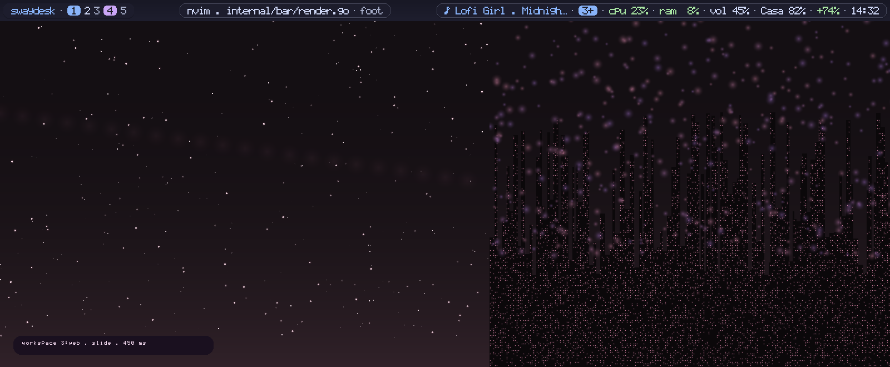
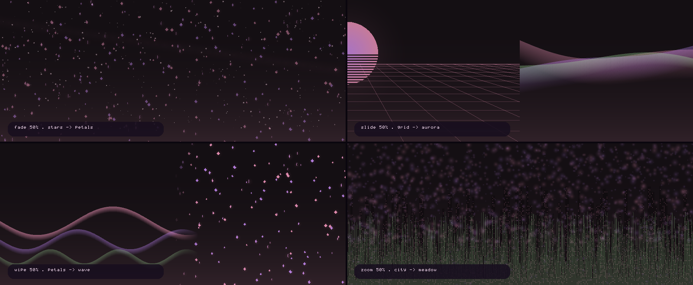

# Personalización

## 1. Ajustes generales

`~/.config/swaydesk/config.toml` es tu archivo. `swaydesk init` no lo pisa (solo
con `--force`, y entonces crea `.bak-<fecha>`).

```toml
[general]
theme = "tokyonight"
nerd_font = true
terminal = "kitty"          # foot, kitty, alacritty, wezterm, ghostty, xterm, st
launcher = "swaymenu --float"
editor = "nvim"
file_manager = "thunar"
browser = "chromium"
confirm_power = true        # pedir confirmación antes de reiniciar/apagar

[gtk]
theme = "auto"             # sigue la paleta: Adwaita o Adwaita-dark
icon_theme = "auto"        # Papirus / Papirus-Dark, o indica otro tema instalado

[ui]
font = "JetBrainsMono Nerd Font"   # vacío = autodetección con fc-list
font_size = 11
bar_font_size = 13
width = 72                  # columnas de la ventana flotante (900px aprox.)
height = 20
border = "rounded"          # rounded, square, double, thick, ascii

[input]
keyboard_layout = "latam"   # latam, us, es, de, fr, br...

[boot]
enabled = true              # animación al iniciar la sesión
style = "sakura"            # sakura (pétalos), neon (lluvia), matrix, minimal
duration_ms = 2600          # 0 = automática
logo = true                 # logotipo grande en bloques

[wallpaper]
kind = "scene"              # scene, image, gif, video, none
name = "petals"             # escena procedural (swaydesk wallpaper list)
path = ""                   # ruta del archivo cuando kind es image/gif/video
mode = "fill"               # fill, fit, stretch, center, tile
fps = 30                    # fotogramas por segundo máximos
protocol = "auto"           # auto, kitty, sixel, ansi (solo vista en terminal)
adaptive = false            # aplicar automáticamente un tema derivado del fondo
dir = "~/Imágenes/Fondos"   # carpeta que explora el selector

[effects]
terminal_opacity = 0.94     # alpha de foot (1 = opaco)
bar_opacity = 0.68          # alpha de waybar
active_opacity = 1.00       # ventana enfocada
inactive_opacity = 0.94     # ventanas sin foco
blur = false                # requiere swayfx
gaps_inner = 6
gaps_outer = 8
rounding = 12               # requiere swayfx
```

Después de editar:

```bash
swaydesk apply     # regenera waybar/foot/mako/swaylock y recarga
swaymsg reload     # solo si cambiaste la plantilla de sway
```

## 2. Temas

Con la galería interactiva (`Super+t` o `swaydesk theme --gallery`) puedes
recorrer todas las paletas viendo la vista previa en vivo: degradados, muestras,
ventana de ejemplo y el fondo animado de cada tema.

```bash
swaydesk theme                # lista agrupada por categoría
swaydesk theme sakura         # aplica una paleta
swaydesk theme --gallery      # selector a pantalla completa
swaydesk theme --from-wallpaper   # paleta derivada de los colores del fondo
swaydesk theme --json         # catálogo en JSON (para scripts)
```

Las categorías son `anime`, `oscuro`, `retro`, `claro` y `adaptativo`. El atajo
`Tab` cambia de categoría dentro de la galería y `espacio` pausa la animación de
la vista previa.

### Thunar, GTK e iconos

Thunar es el gestor de archivos recomendado para Swaydesk. Al cambiar de paleta,
`Swaydesk` genera una hoja GTK 3 con sus colores, sincroniza el modo oscuro y
selecciona `Papirus` o `Papirus-Dark` si el tema de iconos está instalado (si no,
usa `Adwaita`). El tema GTK base se elige entre `Adwaita` y `Adwaita-dark`; puedes
forzar otros temas instalados en `~/.config/swaydesk/config.toml`:

```toml
[gtk]
theme = "auto"                 # o el nombre de un tema GTK 3 instalado
icon_theme = "Papirus-Dark"    # o "auto", "Papirus", "Adwaita", etc.
```

Instala Thunar, el juego de iconos y complementos útiles en Arch:

```bash
sudo pacman -S thunar papirus-icon-theme tumbler gvfs thunar-archive-plugin thunar-volman
```

La opacidad está preparada para Thunar nativo de Wayland (`app_id=thunar`) y
para XWayland (`class=Thunar`), al valor de `effects.inactive_opacity`. Si ya
habías generado Sway antes de instalar Thunar, actualiza solo ese archivo y
recarga:

```bash
swaydesk init --force --only sway
swaymsg reload
```

Los cambios GTK se guardan y se notifican por GSettings cuando está disponible.
Si una ventana de Thunar abierta no actualiza su hoja de estilos, ciérrala y
vuelve a abrirla.

### Temas adaptativos

`swaydesk theme --from-wallpaper` (o `swaydesk wallpaper adaptive [archivo]`)
analiza el fondo, extrae sus colores dominantes y construye una paleta completa
—fondo, superficies, texto, acentos, estados y gradiente— ajustada para cumplir
un contraste mínimo legible. Se guarda como una paleta normal en
`~/.config/swaydesk/themes/adaptativo.toml`, así que puedes editarla a mano y
aplicarla como cualquier otra.

```bash
swaydesk theme                  # lista con muestras de color
swaydesk theme gruvbox          # cambia y aplica en caliente
swaydesk theme --gallery        # selector interactivo (Super+t)
swayctl                         # pestaña "Apariencia" (Super+i, Tab ×3)
```

`swaydesk theme X` reescribe:

| Archivo | Qué cambia |
|---|---|
| `~/.config/waybar/style.css` | barra de estado (recarga con `SIGUSR2`) |
| `~/.config/foot/foot.ini` | terminal |
| `~/.config/mako/config` | notificaciones |
| `~/.config/swaylock/config` | pantalla de bloqueo |
| `~/.config/gtk-3.0/settings.ini` y `gtk.css` | tema GTK, paleta e iconos de Thunar/otras apps GTK 3 |
| sesión GTK vía GSettings (si está disponible) | tema/iconos para aplicaciones ya abiertas |
| sesión de sway vía IPC | colores de borde y de título de las ventanas |

Si el fondo es una escena, GIF, vídeo o tiene reglas por workspace, el demonio se
reinicia desacoplado del proceso que cambia el tema para actualizar la paleta sin
quedarse ligado al selector. Las imágenes estáticas no se tocan. Compruébalo con
`swaydesk wallpaper status`.

### Añadir tu propia paleta

En `internal/ui/theme.go`, dentro de `BuiltinPalettes`:

```go
"mi-tema": {
    Name: "Mi tema",
    Bg: "#101418", BgAlt: "#0b0e11", BgSel: "#1d242c",
    Fg: "#e6e6e6", FgDim: "#b0b6bd", Muted: "#6b7280",
    Accent: "#7dd3fc", Accent2: "#c084fc",
    Ok: "#86efac", Warn: "#fde047", Err: "#f87171", Border: "#2b3440",
},
```

Añade el nombre a `PaletteNames()` y recompila. Aparecerá en todos los menús.

## 3. Atajos de teclado

Los binds viven en `~/.config/sway/config`, generado desde
[`assets/files/sway/config`](../assets/files/sway/config).

- **Override rápido sin tocar lo generado**: edita
  `~/.config/sway/config.d/90-user.conf` (se incluye al final, así que gana):

```conf
bindsym Super+Shift+s exec spotify
bindsym Super+F1 exec swaydesk screenshot region
for_window [app_id="pavucontrol"] floating enable, resize set 800 500
output HDMI-A-1 resolution 2560x1440@144Hz position 0,0 scale 1
output eDP-1 scale 1.25
```

- **Cambiar algo de la plantilla** (para que sobreviva a `init --force`): edita
  el archivo en `assets/files/sway/config` y ejecuta
  `swaydesk init --force --only sway`.

Recarga siempre con `Super+Shift+c` o `swaymsg reload`. Por defecto, `Print`
captura toda la pantalla y `Super+Print` / `Super+Shift+Print` seleccionan una
región; todas guardan el PNG en `~/Capturas` (fuera de `~/Imágenes`), lo copian
al portapapeles como `image/png` y muestran una notificación textual con la ruta.
Al ejecutar `swaydesk apply`, los atajos predeterminados antiguos de `grim` se
migran sin reemplazar el resto de Sway.

## 4. Menús y acciones

### Lanzador

- Al abrirse, muestra «cargando aplicaciones…» mientras descubre las entradas
  `.desktop` en segundo plano; puedes empezar a escribir mientras termina.
- Los comandos del `PATH` no se listan por defecto (son cientos y ensucian).
  `Super+Shift+d` (`swaymenu --float --commands`) los incluye.
- El filtrado difuso reutiliza resultados mientras navegas y recalcula solo al
  cambiar el texto o la lista. El historial está en `~/.cache/swaydesk/history`;
  bórralo para reiniciar el orden de resultados.
- La calculadora se activa empezando el filtro por `=`:
  `=2^10`, `=sqrt(144)+3`, `=100*1.19` (IVA), `=round(2.5)`.
- El lanzador no muestra acciones de energía ni de bloqueo. Usa `Super+P` para
  abrir el menú de energía y `Super+Shift+L` para bloquear la pantalla; ambos
  atajos se conservan en la configuración de Sway.

### Añadir una acción al menú

En `cmd/swaymenu/main.go`, dentro de `buildItems`, añade una entrada a `builtin`:

```go
{"captura-todo", "Captura: pantalla completa", "grim", theme.Icons.Camera, "grim"},
```

El último campo es el binario requerido: si no está instalado, la acción no se
muestra. Para lógica propia, añade un caso en `runAction`:

```go
case "captura-todo":
    fail(actions.Screenshot("full"))
```

### Portapapeles

```bash
swayclip                 # autodetecta cliphist, clipman o wl-paste
swayclip --backend clipman
```

Para tener historial persistente, `~/.config/swaydesk/autostart.sh` arranca
vigilantes de texto e imágenes con `cliphist` si está instalado. `swayclip`
identifica las entradas de imagen y `Enter` restaura su MIME (por ejemplo,
`image/png`) al portapapeles; la vista previa se mantiene textual. Puedes borrar
la entrada seleccionada con `Ctrl+d`.

### Si no aparecen OSD, notificaciones o la animación de arranque

El autostart nuevo inicia `swaynotify`, `swayosd watch` y el demonio de fondos,
pero una instalación con `--no-config` deja intactos los archivos de inicio que
ya existían. Comprueba primero `swaydesk doctor`; si marca `autostart swaydesk`
como antiguo, actualiza solo ese archivo (se crea un respaldo) y recarga Sway:

```bash
swaydesk init --force --only swaydesk/autostart.sh
swaymsg reload
tail -n 80 "${XDG_CACHE_HOME:-$HOME/.cache}/swaydesk/autostart.log"
```

Pruebas manuales útiles: `swaydesk osd show`, `swaydesk notifications test`,
`swaydesk wallpaper status` y `swaydesk boot`. Si el aviso o la notificación
fallan también al lanzarlos manualmente, conserva el mensaje de error y el
registro de autostart para localizar el problema concreto.

### Si un fondo no se aplica

- **Escenas, GIF y vídeo los dibuja el demonio** (`swaydesk wallpaper daemon`).
  `set` y la galería ya lo arrancan o lo reinician solos. `swaydesk wallpaper
  status` dice si está `activo (pid N)` o `detenido: por eso no se ve el fondo`.
- Si el demonio **no arranca**, ahora se ve el motivo: su salida va a
  `~/.cache/swaydesk/wallpaper.log` y `swaydesk wallpaper logs` lo muestra (con
  `--clear` lo vacía). Al arrancarlo se comprueba que siga vivo un par de
  segundos; si murió, se imprime el registro en lugar de un «✔» falso.
- Si el registro dice `connection reset by peer`, actualiza el binario: una
  versión anterior enviaba IDs Wayland incorrectos al crear superficies de
  fondo/paneles, y el compositor cerraba el socket. Ahora también se informa
  el `wl_display.error` concreto si aparece otro error de protocolo.
- `swaydesk doctor` incluye el chequeo **demonio de fondo**, que solo exige el
  demonio cuando el fondo actual lo necesita.
- Una **imagen fija** no necesita demonio: se aplica al instante con
  `output * bg` vía IPC y queda escrita en
  `~/.config/sway/config.d/50-wallpaper.conf`, que se carga al recargar sway.
- `Super+Shift+w` ejecuta `swaydesk wallpaper --gallery`. Si el atajo no hace
  nada, prueba esa orden en la terminal: el error te dirá si falta el binario
  (`swaydesk keys` → ✘), si es la versión antigua (`swaydesk: comando
  desconocido "keys"`) o si no hay terminal configurada.
- Los archivos se buscan en `wallpaper.dir` (por defecto `~/Imágenes/Fondos`) y
  en `~/Imágenes`, `~/Pictures`, `~/Vídeos`, **incluidas las subcarpetas**.
- Con `sway` puro (sin swayfx) las escenas también funcionan: usan
  `wlr-layer-shell`, no efectos del compositor.

### Si `swaydesk: orden no encontrada`

Los binarios se instalan en `~/.local/bin`, que muchas veces no está en el
`PATH` (`Arch` trae por defecto solo `~/bin`). Soluciones, de la más rápida a la
más definitiva:

```bash
export PATH="$HOME/.local/bin:$PATH"          # solo esta terminal
~/.local/bin/swaydesk keys                    # sin tocar nada, ruta completa
```

El instalador ya añade la línea a `~/.bashrc`, `~/.zshrc` y `~/.profile` (se
puede evitar con `--no-path`), y `swaydesk doctor` lo comprueba:

```
  • PATH                   /home/shadow/.local/bin/swaydesk (falta en el PATH)
    → añade ~/.local/bin al PATH (o reejecuta scripts/install.sh)
```

La sesión de sway es otro mundo: **no lee tus `.bashrc`**, así que la
configuración generada escribe rutas absolutas para los binarios y
`autostart.sh` empieza con `PATH="$HOME/.local/bin:$PATH"`. Si arrancas sway
desde una TTY, añade la línea a `~/.profile` (lo hace el instalador).

### Si un atajo no hace nada

sway **falla en silencio**: si el programa de un `bindsym … exec` no existe (por
ejemplo porque los binarios están en `~/.local/bin` y esa carpeta no está en el
`PATH` de la sesión), la tecla simplemente no hace nada y no hay ningún error.

Para eso está `swaydesk keys`, que lee la configuración **que sway tiene
cargada** (por IPC), expande las variables y comprueba cada programa:

```bash
swaydesk keys                 # todos los atajos
swaydesk keys swaydesk        # solo los que mencionan «swaydesk»
swaydesk keys --exec          # solo los que lanzan programas
```

Salida de ejemplo:

```
  atajos de sway · sway (config en vivo)
  98 atajos · 2 con problemas

  ✔ Mod4+Return              foot
  ✔ Mod4+t                   /home/shadow/.local/bin/swaydesk theme --gallery
  ✘ Mod4+n                   swaydesk notifications center
      → no se encuentra el programa "swaydesk"
```

Detecta tres cosas: **programas que no existen**, **teclas repetidas** (sway se
queda con la última y se pierde la primera) y si la sesión va por detrás del
archivo (editaste y no recargaste; avisa con `swaymsg reload`).

Si los binarios viven en `~/.local/bin`, la configuración generada los usa con
**ruta absoluta** (`swaydesk init` la resuelve al escribir), así que los atajos
funcionan aunque sway no herede tu `PATH`. `Super+i` y `Super+c` ejecutan
interfaces TUI; al no tener TTY, detectan la situación y se relanzan en una
terminal flotante con el identificador de ventana adecuado.

Los atajos que lanzan programas que no tienes instalados se marcan igual
(`thunar`, `brightnessctl`…): al final del listado sale un resumen con los que
faltan. `swaydesk init` prueba alternativas antes de escribir el archivo: si no
tienes `thunar` usa `nautilus`, `dolphin`, `nemo`, `pcmanfm`, `xdg-open`…; para
la terminal y el navegador hace lo mismo.

> **Cuidado con los respaldos**: `swaydesk init --force` deja copias
> `*.bak-<fecha>` junto a los archivos. Si están dentro de
> `~/.config/sway/config.d/`, un `include …/config.d/*` las cargaría y volverían
> a aparecer atajos viejos y teclas duplicadas. La plantilla ya usa
> `include ~/.config/sway/config.d/*.conf`, pero si vienes de una versión
> anterior bórralas una vez:
>
> ```bash
> rm -f ~/.config/sway/config.d/*.bak-* ~/.config/sway/*.bak-*
> ```

Para regenerar solo la configuración de sway sin tocar tu `config.toml` ni el
resto de archivos:

```bash
swaydesk init --force --only sway
swaymsg reload
```

### Autostart

`~/.config/swaydesk/autostart.sh` es el script que sway lanza al arrancar
(`exec_always`). Cada bloque comprueba que el programa exista, así que no falla
si te falta algo. Añade tus programas al final:

```sh
quiet chromium
quiet nm-applet
quiet blueman-applet
```

**Se puede ejecutar las veces que haga falta.** `exec_always` significa que sway
también lo lanza en cada `swaymsg reload`; por eso el script usa dos ayudas:

- `once <programa> [args…]` — arranca solo si no está ya en marcha (`pgrep -x`).
  Así la barra, `swaynotify`, `swayosd watch`, `swayidle`, los vigilantes de
  `wl-paste`, el agente de polkit y el portal no se duplican al recargar… y si
  uno se cerró, el siguiente reload lo recupera.
- `una_vez <clave>` — lo que solo debe pasar una vez por sesión: la animación de
  arranque y el aviso de bienvenida. La marca lleva el `SWAYSOCK` de la sesión,
  que cambia al reiniciar sway pero no al recargar.

Si usas tus propios programas en el script, envuélvelos igual (`once firefox`)
para que un reload no te abra una segunda ventana.

```sh
# Tras actualizar swaydesk: reinstala solo el script del autostart
swaydesk init --force --only swaydesk/autostart.sh
swaydesk reload
```

Si alguna vez te encuentras varias barras o varios demonios (por ejemplo, de
antes de esta versión), límpialos una vez a mano:

```sh
pkill -x swaybar; pkill -x swaynotify; pkill -x swayosd; pkill -x swayidle
~/.config/swaydesk/autostart.sh
```

## 5. Fondos animados

```bash
swaydesk wallpaper list                  # escenas y archivos encontrados
swaydesk wallpaper set scene:sakura      # cambia la escena
swaydesk wallpaper set ~/Imágenes/a.gif --live
swaydesk wallpaper set ~/Vídeos/b.mp4    # requiere ffmpeg
swaydesk wallpaper status                # tipo, demonio y compositor
swaydesk wallpaper stop                  # detiene el fondo animado
```

`--live` (o `swaydesk wallpaper daemon`) arranca el demonio que dibuja el fondo
en una capa `wlr-layer-shell` **detrás de las ventanas**; la superficie cubre la
salida completa, también el espacio reservado por la barra, para que el GIF siga
visible detrás de sus zonas translúcidas. El autostart lo lanza al iniciar
sesión. Para GIF y vídeo, Sway mantiene un color sólido del tema como respaldo;
así no queda un primer fotograma estático superpuesto al fondo animado.

Escenas disponibles: `petals`, `snow`, `stars`, `rain`, `aurora`, `wave`,
`city`, `embers`, `grid`, `meadow`, `bubbles`. Cada una toma los colores del
tema activo, así que cambiar de paleta cambia el fondo.

También puedes usar el nombre de una paleta y swaydesk toma su escena asociada:
`swaydesk wallpaper set scene:sakura` es lo mismo que `scene:petals`, y
`miku` equivale a `wave`.

El respaldo gestionado por swaydesk se escribe en
`~/.config/sway/config.d/50-wallpaper.conf`: imágenes fijas usan su ruta; GIF,
vídeo y escenas usan un color sólido mientras el demonio Wayland dibuja la
animación. Puedes sobrescribirlo con tus propias reglas `output * bg ...`.

### Un fondo por workspace

El fondo puede cambiar según el workspace que estés mirando. Las reglas van en
`[wallpaper.workspaces]` y la clave puede ser el **nombre** del workspace, su
**número** o el **sufijo tras `:`** (así `web` vale para `3:web`):

```toml
[wallpaper]
kind = "scene"
name = "aurora"            # fondo base para el resto de workspaces
transition = "slide"       # fade · slide · wipe · zoom · none
transition_ms = 450        # 0–5000

[wallpaper.workspaces]
"1" = "scene:petals"
"2" = "image:~/Imágenes/Fondos/ciudad.png"
"3:web" = "scene:grid"
dev = "video:~/Vídeos/lofi.mp4"
```

No hace falta reiniciar para probarlo:

```bash
swaydesk wallpaper workspaces                     # reglas, workspace actual y demonio
swaydesk wallpaper workspaces set 3:web scene:grid
swaydesk wallpaper workspaces set dev ~/Vídeos/lofi.mp4
swaydesk wallpaper workspaces unset 2
swaydesk wallpaper workspaces clear
swaydesk wallpaper transition slide 450           # tipo y duración
swaydesk wallpaper transition                     # la actual
```

Al guardar, el demonio se inicia o reinicia automáticamente cuando las reglas
por workspace lo necesitan, incluso si el fondo base es una imagen fija; al
quitar la última regla, se detiene si ya no hace falta. También se acepta la
forma compacta `workspaces = ["1=scene:petals", "dev=scene:city"]` dentro de
`[wallpaper]`.

Cómo se comporta:

- La resolución va por **nombre completo** (sin distinguir mayúsculas), luego
  por el **sufijo tras `:`** y por último por el **número**; si nada coincide se
  usa el fondo base. `3:web` prefiere su regla exacta antes que la de `web`.
- El demonio escucha los **eventos de workspace de sway** por IPC (sin sondear)
  y cambia en el acto. Si sway no está, sigue dibujando el fondo actual y
  reintenta la conexión cada dos segundos.
- Durante la transición se **congela el último fotograma** del fondo viejo y se
  mezcla con los fotogramas nuevos a ~60 fps; al terminar se libera el motor
  anterior (los vídeos cierran su tubería de ffmpeg). Con `transition = "none"`
  o `transition_ms = 0` el cambio es instantáneo.
- El fondo es una sola capa para toda la pantalla, así que manda el workspace
  **enfocado**. Con varios monitores, cada uno con su workspace enfocado, se
  dibuja el del último foco; para fondos distintos por pantalla conviene una
  regla de salida en sway.
- Al arrancar se aplica ya el fondo del workspace enfocado, sin transición.

| Transición | Efecto |
| --- | --- |
| `fade` | fundido cruzado con curva suave (el clásico) |
| `slide` | el fondo viejo se va a la izquierda y el nuevo entra por la derecha |
| `wipe` | barrido de izquierda a derecha con borde difuminado |
| `zoom` | el fondo nuevo crece desde el centro mientras aparece |
| `none` | corte seco |





### Vista previa en la terminal

```bash
swaydesk wallpaper play           # el fondo actual a pantalla completa
swaydesk wallpaper gallery        # selector con vista previa animada
```

Teclas en la reproducción: `q`/`Esc` salir, `espacio` pausar, `+`/`-` FPS,
`i` ocultar la ayuda. En terminales con protocolo gráfico (kitty, Ghostty, foot)
se envía la imagen real; si no, se dibuja con medios bloques.

## 6. Animación de arranque

```bash
swaydesk boot                     # la reproduce ahora mismo
swaydesk boot --style=neon        # otro estilo sin tocar la configuración
swaydesk boot --duration=1500     # más corta
swaydesk boot --list              # estilos disponibles
swaydesk boot --no-logo           # sin el logotipo grande
```

La lanza el autostart en una ventana de terminal a pantalla completa
(`app_id=swaydesk-boot`), dentro de sway, con la clase ya configurada en
`assets/files/sway/config`. Se salta con cualquier tecla y desaparece sola.

Estilos:

| Estilo | Efecto |
|---|---|
| `sakura` | pétalos y motas cayendo con la paleta del tema (por defecto) |
| `neon` | lluvia vertical de trazos tipo lluvia digital |
| `matrix` | glifos y dígitos verdes sobre negro |
| `minimal` | sin partículas: solo logotipo, pasos y barra |

La lista de pasos se genera en vivo (`boot.DefaultSteps`): compositor, barra,
notificaciones, portapapeles, tema, fondo y ventanas; cada uno con su estado real.

Para desactivarla del todo, `enabled = false` en `[boot]` (o borra la línea
`swaydesk boot` del autostart). Vuelve a verla cuando quieras con `Super+Shift+b`.

## 7. Translucidez

La mayoría de las aplicaciones de Wayland respetan el alpha de sus propias
superficies, así que swaydesk ajusta cada pieza por separado:

- **foot**: `[colors] alpha` ← `effects.terminal_opacity`.
- **waybar**: `background: alpha(@bg, bar_opacity)` en los módulos y tooltips.
- **mako**: color de fondo y borde con canal alfa derivado del tema.
- **sway**: `client.focused_inactive` / `client.unfocused` con alfa y reglas
  `for_window [app_id=…] opacity …` para terminales, gestores de archivos,
  reproductores y las ventanas flotantes de swaydesk. Añade más con:

```
for_window [app_id="mi-app"] opacity 0.92
```

- **swayfx** (opcional): si está instalado, `swaydesk apply` añade
  `corner_radius` y, con `blur = true`, `blur enable`. En sway normal esas
  líneas quedan comentadas porque no existen.

### Añadir cualquier aplicación

`swaydesk opacity` gestiona reglas de translucidez sin editar archivos a mano:

```bash
swaydesk opacity presets              # catálogo de apps conocidas
swaydesk opacity all                  # escribe las ~40 reglas del catálogo
swaydesk opacity add obsidian 0.92    # añade (o ajusta) una app
swaydesk opacity add --class Spotify 0.9   # por clase en vez de app_id
swaydesk opacity remove obsidian      # quita la regla
swaydesk opacity list                 # reglas propias activas
swaydesk opacity reset                # vuelve a la plantilla de sway
```

Las reglas se guardan en `~/.config/sway/config.d/60-opacity.conf` y se aplican
en caliente por IPC a las ventanas abiertas, además de a las futuras. Para
descubrir el `app_id` real de una ventana:

```bash
swaymsg -t get_tree | grep app_id
```

## 8. Barra de estado propia (`swaybar`)

Desde la versión con `swaybar`, el escritorio trae su propia barra: un solo
binario que dibuja islas redondeadas, translúcidas, con tipografía de mapa de
bits (PSF) y los colores del tema activo. No necesita waybar, GTK ni ninguna
librería gráfica. Todo se configura en `[bar]` de `~/.config/swaydesk/config.toml`:

```toml
[bar]
enabled = true             # false = vuelve a waybar automáticamente
position = "top"           # top · bottom
height = 38                # alto en píxeles
margin = 6                 # separación con los bordes de la pantalla
padding = 14               # relleno interior de cada isla
gap = 10                   # hueco entre islas
radius = 0                 # 0 = pastilla completa
opacity = 0.68             # transparencia de las islas
islands = true             # false = una sola barra continua
logo = true
font = ""                  # ruta a un .psf / .psf.gz; vacío = fuente del sistema
font_scale = 1.0
shadow = true              # sombra suave bajo las islas
exclusive = true           # las ventanas no se solapan con la barra
modules = ["media", "notify", "volume", "network", "battery", "clock"]
```

Módulos disponibles: `media` (reproductor vía `playerctl`), `recording`
(indicador de `wf-recorder`), `cpu`, `ram`, `disk`, `temp`, `uptime`,
`volume`, `network`, `battery`, `updates`, `title` (ventana enfocada), `clock`,
`clock24` y `date`. No hay un módulo ni botón de energía en swaybar: usa
**Super+P**, que abre `swaymenu --power --float` en una ventana flotante.

```bash
swaydesk bar                  # estado y módulos actuales
swaydesk bar modules media notify volume network battery clock
swaydesk bar opacity 0.68     # opacidad común (0 = invisible, 1 = opaco)
swaydesk bar off              # desactiva swaybar; el autostart usa waybar
swaydesk bar preview --width 1600 --out ~/barra.png   # PNG sin sesión gráfica
swaybar --demo --preview      # datos de ejemplo, útil para probar el diseño
```

Plantea la barra con varios anchos y comprueba que el centro no se solapa; si
quieres la barra flotante estilo "isla", deja `islands = true` y sube `margin`.

### Añadir un módulo nuevo

Los módulos viven en `internal/bar/render.go` (`rightItems`) y los datos en
`cmd/swaybar/data.go`. Un módulo es una entrada de texto con color opcional y
un estado alternativo (`ok`/`warn`/`error`) para casos como batería baja o red
caída.

### Todo el camino de vuelta a waybar

Si prefieres waybar y sus módulos personalizados, pon `enabled = false` en
`[bar]` (o ejecuta `swaydesk bar off`) y aplica el cambio con `swaymsg reload`.
El autostart detiene la barra que no corresponde a la opción elegida antes de
iniciar la otra, así no quedan Waybar y swaybar superpuestas. Si el archivo
`~/.config/waybar/config.json` existe, Waybar se inicia con `--config` explícito:
varias versiones ignoran `config.json` al buscar automáticamente y caen en
`/etc/xdg/waybar/config.jsonc`. La hoja de estilos de swaydesk se mantiene en
`~/.config/waybar/style.css` y se colorea con el tema activo. En esa plantilla
el centro muestra hora, día de la semana y fecha, sin icono delante; el texto
es un poco más grande, no cambia de formato al hacer clic y ya no aparece el
título de ventana ni se repite el reloj a la derecha. Al pasar el puntero sobre
el reloj, Waybar abre el calendario mensual en español, ampliado y con la semana
iniciando el lunes; la rueda del mouse avanza o retrocede un mes. Los rótulos de
volumen, red, temperatura y batería están en español; la plantilla ya no muestra
métricas de CPU ni memoria. El modo de teclado se llama
`redimensionar` y el indicador de grabación dice `GRABANDO`. Los nombres de apps y
redes que vienen de la bandeja o del sistema conservan el idioma que les da cada
aplicación.

## 8c. Notificaciones propias (`swaynotify`)

El escritorio trae su propio daemon de notificaciones: implementa
`org.freedesktop.Notifications` (así que Chromium, mpd, pacman, tu script de
copias… todo funciona sin tocar nada) y dibuja las tarjetas en píxeles sobre
una capa overlay, con la fuente y los colores del tema activo.

```toml
[notify]
enabled = true             # false = usar mako
position = "top-right"     # top-right, top-left, bottom-right, bottom-left
width = 300                # ancho compacto de cada tarjeta
margin = 14                # separación con el borde de la pantalla
padding = 10               # relleno interior
gap = 6                    # separación entre tarjetas
radius = 12                # esquinas redondeadas
opacity = 0.94             # transparencia de las tarjetas
timeout_ms = 6000          # tiempo en pantalla de las normales
critical_timeout_ms = 0    # 0 = las urgentes se quedan hasta cerrarlas
max_visible = 4            # cuántas se apilan
history = 50               # entradas que se guardan
max_lines = 2              # máximo de líneas del cuerpo para reducir altura
dnd = false                # arrancar en modo «no molestar»
group = true               # agrupar por aplicación en pilas desplegables
font = ""                  # fuente PSF (vacío = automática)
font_scale = 0             # 0 = automática
```

En instalaciones ya configuradas, edita `~/.config/swaydesk/config.toml`:
los valores guardados prevalecen sobre estos valores predeterminados.

Los rótulos y controles propios aparecen en español; algunas acciones genéricas
que las aplicaciones envían en inglés (Open, Reply, Dismiss, etc.) se traducen.
El título y el cuerpo del aviso son texto de la aplicación y se muestran tal como
llegan: para traducirlos hay que cambiar el idioma de esa aplicación.

### Qué se dibuja

- **Punto de color** según la urgencia: acento (normal), atenuado (baja) y
  error (crítica, que además lleva el borde marcado).
- **Aplicación y hora** arriba, con el resumen compacto por defecto (destacado
  en tarjetas anchas) y el cuerpo recortado a `max_lines` líneas.
- **Acciones** como botones `[Etiqueta]`: se pulsan con el ratón y el cliente
  recibe `ActionInvoked`.
- **Barra de progreso** con el hint `progress` (descargas, copias…).
- **Cuenta atrás**: una línea fina se va vaciando hasta que la tarjeta
  desaparece sola. Un clic en cualquier parte de la tarjeta la cierra
  (`NotificationClosed` con motivo 2).

### Notificaciones agrupadas

Con `group = true` (por defecto), todos los avisos de una misma aplicación se
apilan en **una sola tarjeta**: las capas asoman por debajo, un contador indica
cuántos hay y la línea grande muestra el último mensaje seguido de «y N más».

- **Un clic** en la tarjeta (o en `[ver N]`) despliega la pila: aparece la franja
  del grupo —con `[plegar]`— y debajo una tarjeta por aviso, en orden.
- **Clic derecho** en cualquier tarjeta de la pila la cierra entera; el clic
  izquierdo en una tarjeta suelta la cierra como siempre y en la franja pliega
  el grupo.
- El modo «no molestar» y la caducidad funcionan igual; `max_visible` cuenta
  **pilas**, no avisos, así que cinco mensajes del mismo chat ocupan el hueco de
  uno solo.
- Cada cliente puede separar sus pilas con una etiqueta: se aceptan
  `x-dunst-stack-tag`, `x-kde-group-id` y `group` como hints de cadena. Sirve
  para no mezclar «chat de Marta» y «chat de Luis» de la misma aplicación:

```bash
swaynotify send --app Telegram --group chat-marta --reply "Marta" "¿Comemos?"
swaynotify send --app Telegram --group chat-marta "Marta" "Traigo el postre"
```

- En el centro (`swaydesk notifications center`) las pilas se ven como una fila
  con el número de avisos: `Enter`/`Tab` la abre, `g` quita o pone el
  agrupamiento y `x` cierra la pila completa.

### Imágenes en las tarjetas

Cuando un aviso trae **arte** (una carátula, la foto de perfil de un chat, la
miniatura de una descarga), la tarjeta lo dibuja como una **miniatura cuadrada
de 42 px lógicos** a la izquierda, con las esquinas redondeadas y un borde
sutil; el resumen y el cuerpo se recolocan a su derecha y la tarjeta crece lo
justo para que no se solapen. Si el hueco interior es muy estrecho (menos de
60 px) la miniatura se omite y el texto vuelve a ocupar todo el ancho.

Se aceptan las tres formas habituales de mandar la imagen:

| Hint | Formato | Quién lo usa |
| --- | --- | --- |
| `image-data` (también `image_data`) | firma D-Bus `(iiibiiay)`: ancho, alto, salto de fila, alfa, bits, canales y píxeles | reproductores MPRIS, Telegram, Discord, `notify-send -i` con archivo |
| `image-path` (también `image_path`) | ruta a un PNG/JPEG/GIF (admite `file://` y `~`) | mako, dunst y la mayoría de scripts |
| `app_icon` | si es una **ruta** y no hay imagen propia, se usa como miniatura | apps que solo rellenan el icono |

El decodificador (`internal/notify/image.go`) está escrito desde cero con la
biblioteca estándar: entiende PNG, JPEG y los formatos que registra Go, respeta
el **salto de fila** y el canal alfa del búfer crudo, y convierte todo a RGBA
para poder mezclarlo con el tema. Límites pensados para no bloquear la sesión:

- lado mayor **512 px** al entrar (el resto se reduce por caja, sin vecinos
  borrosos) y miniatura final recortada al centro;
- **8 MiB** por archivo y **12 MiB** por hint de D-Bus; lo que pase se ignora
  sin romper la notificación;
- una imagen ilegible nunca hace fallar el aviso: la tarjeta se dibuja sin ella.

```bash
# Lo más rápido para verlo
swaynotify send --app spotify --timeout -1 \
    --image ~/Música/caratulas/lofi.png \
    "Lofi Girl · Midnight Study" "Reproduciendo la lista «estudio»"

# Un cliente puede mandar los píxeles por D-Bus (equivalente a image-data)
notify-send -i ~/fotos/perfil.png "Marta" "¿Comemos a las dos?"
```

El **historial** guarda solo la ruta (`image_path`), no los píxeles: al abrir el
centro las imágenes se **recargan del disco** para no llenar el JSON. Si el
archivo ya no existe, la entrada se ve como siempre, sin miniatura. En el
centro esas filas llevan la insignia `imagen`.

### Responder desde la tarjeta (`inline-reply`)

Los chats (Telegram, Signal, Discord, el cliente de Matrix…) pueden pedir una
**respuesta rápida**. Cuando una aplicación declara la capacidad `inline-reply`
y añade la acción con clave `inline-reply`, la tarjeta muestra un último botón,
**Responder**, con el texto de ayuda que manda la app en el hint
`x-kde-reply-placeholder-text`:

```bash
swaynotify send --app "Chat" --reply --reply-hint "Responder a Marta…" \
    --timeout 20000 "Marta" "¿Comemos a las dos?"
```

Al pulsarlo se abre una **ventana flotante de terminal** (`swaynotify reply
<id>`) con el campo de escritura; la tarjeta queda retenida (`Hold`) para que
no caduque mientras escribes. Al confirmar con `Enter`:

1. Se sanea el texto: una sola línea, sin caracteres de control, máximo
   `MaxReplyLen` (512) caracteres.
2. El daemon emite **`NotificationReplied(id, texto)` en modo *unicast*, solo
   al cliente que creó la notificación**. El texto no se difunde por el bus.
3. La tarjeta se cierra salvo que la app la haya marcado como `resident`.

La continuación natural es el **centro de notificaciones**: una TUI con todo lo
que hay en pantalla y el historial, filtro incremental, y las mismas acciones.

```bash
swaydesk notifications center      # también con clic en el indicador de la barra
swaynotify reply 7 "voy saliendo"  # respuesta directa, sin interfaz
```

Teclas del centro: `↑`/`↓` mover, `Enter` abrir la pila o actuar (responder si
se puede, si no cerrar), `Tab` desplegar o plegar el grupo, `g` agrupar por
aplicación, `r` responder, `x` cerrar (la pila entera si es un grupo), `m` no
molestar, `c` cerrar todas, `X` borrar historial, `F5` recargar, `Esc` salir (o
borrar el filtro).

El indicador de la barra es el módulo `notify`: muestra una pastilla con el
número de avisos en pantalla (con `+` si alguno admite respuesta), `dnd` en
ámbar cuando el modo «no molestar» está activo y `avisos` en gris cuando no hay
nada. Un clic izquierdo abre el centro en una terminal flotante.

### Desde el terminal

```bash
swaydesk notify "Compilación terminada" "Todo en verde"        # lo normal
swaynotify send --app pacman --urgency urgente --timeout -1 \
    --action "default=Abrir" "12 paquetes" "Reinicia al terminar"
swaynotify send --app spotify --image ~/caratula.png \\
    "Lofi Girl" "Midnight Study"          # tarjeta con miniatura

swaydesk notifications status          # daemon, DND, en pantalla, historial
swaydesk notifications dnd on          # silenciar (las urgentes pasan)
swaydesk notifications history         # últimas 20, con --json para scripts
swaydesk notifications clear --all     # cerrar y borrar historial
swaydesk notifications preview         # PNG con tarjetas de ejemplo
```

El daemon atiende además una interfaz propia, `org.swaydesk.Notifications`,
con `SetDND`, `ToggleDND`, `GetStatus`, `ListHistory`, `CloseAll`,
`ClearHistory` y `Dismiss`; sirve para integrarla en la barra o en scripts con
`busctl --user call org.freedesktop.Notifications /org/freedesktop/Notifications org.swaydesk.Notifications ToggleDND`.

### Detalles que conviene saber

- Sin bus de sesión (`DBUS_SESSION_BUS_ADDRESS`) el daemon no puede arrancar.
  En una sesión de sway normal lo levanta `dbus-update-activation-environment` /
  `dbus-launch`; el autostart lo comprueba antes de lanzarlo.
- Solo puede haber un servidor de notificaciones. Si `notify.enabled = true`,
  el autostart detiene `mako`/`dunst` antes de iniciar `swaynotify`; si está
  desactivado, conserva `dunst` si ya está activo o inicia `mako` como reserva.
- El historial se guarda en `~/.cache/swaydesk/notificaciones.json` cada cinco
  segundos y al salir, así que sobrevive a un reinicio de la sesión.
- Si un aviso llega con `replaces_id`, se actualiza la tarjeta en el sitio en
  lugar de apilar otra (barras de progreso que se refrescan, por ejemplo).

## 8d. Avisos en pantalla (`swayosd`)

El nivel de volumen aparece en una **tarjeta flotante** con porcentaje y barra
segmentada. Además, al cambiar de pista, los reproductores compatibles con
MPRIS (por ejemplo, mpv, Spotify o Chromium) pueden mostrar una tarjeta con
**título, artista y carátula**. Ambas se desvanecen solas y no interceptan
clics; el aviso lo dibuja el escritorio, no cada reproductor. Sus rótulos son
`VOLUMEN` y `SILENCIADO`; los estados de reproducción también se muestran en
español.

```toml
[osd]
enabled = true             # OSD de volumen; no desactiva el control de audio
media_enabled = true        # tarjeta MPRIS al cambiar de pista
media_timeout_ms = 3200     # duración del OSD de reproducción
position = "bottom-center" # bottom-right, bottom-left, top-center, center
width = 260                # ancho compacto de la tarjeta en píxeles
margin = 72                # separación con el borde de la pantalla
padding = 12               # relleno interior
radius = 14                # esquinas redondeadas
opacity = 0.95             # transparencia del fondo
timeout_ms = 1400          # cuánto tiempo se queda en pantalla
fade_ms = 140              # fundido de entrada y salida (0 = sin animación)
segments = 24              # marcas de la barra de nivel
font = ""                  # fuente PSF (vacío = automática)
font_scale = 0             # 0 = automática; OSD compacto (escala 1)
```

### Cómo se dispara

```bash
swaydesk volume up            # sube 5% y muestra el aviso
swaydesk volume down
swaydesk volume mute
swayosd volume up             # lo mismo, sin pasar por swaydesk
swayosd volume mute --step 3  # pasos más finos
swayosd show                  # solo mostrar el volumen actual
swayosd watch                 # vigilar el volumen y las pistas MPRIS
swayosd media show --title "Hikari" --artist "Aimer" \
  --art-url file:///tmp/cover.png --status Playing
swaydesk osd                  # configuración y volumen actual
swaydesk osd preview osd.png  # PNG del aviso de volumen, sin sesión gráfica
```

Los atajos `XF86AudioRaiseVolume`, `XF86AudioLowerVolume` y `XF86AudioMute`
llaman a `swaydesk volume …`, que usa `swayosd` cuando está instalado. El
autostart deja `swayosd watch` en marcha: vigila el volumen cada 300 ms y
escucha las señales MPRIS del bus D-Bus de sesión. Al iniciar no muestra la
pista que ya estaba sonando; después, una pista nueva dispara la tarjeta. La
carátula acepta URI `file://` o HTTP(S); se omite si ya no está disponible.

Puedes desactivar los avisos por separado: `osd.enabled = false` mantiene la
integración multimedia, mientras `osd.media_enabled = false` deja solo el
volumen. Para apagar ambos, establece los dos en `false`.

### Detalles que conviene saber

- La lectura del volumen usa `wpctl` (PipeWire), luego `pactl` y luego
  `amixer`; con ninguno de los tres el aviso no puede mostrarse, pero el
  escritorio sigue funcionando.
- El OSD de volumen omite el nombre técnico del dispositivo para mantener la
  tarjeta limpia y compacta. `swaydesk osd` todavía permite consultar el
  dispositivo activo en la salida de diagnóstico.
- Por encima del 100% la barra se llena y cambia a color de aviso (volumen
  amplificado); silenciado, la barra queda vacía y una raya la cruza.
- La superficie es una capa `overlay` con la **región de entrada vacía**: el
  aviso nunca se come un clic de lo que haya debajo.
- El fundido se hace dibujando varios fotogramas con alfa creciente; con
  `fade_ms = 0` aparece y desaparece de golpe (menos repintados).

## 8b. Barra de estado (waybar)

`waybar/config.json` y `waybar/style.css` son plantillas. Los módulos de sistema
llaman a `swaydesk status --module`:

```json
"custom/recording": {
  "exec": "swaydesk status --module recording",
  "interval": 2
}
```

Módulos disponibles: `logo`, `recording`, `clock`, `cpu`, `ram`, `battery`,
`volume`, `uptime`, `sway`. Ejemplo de módulo nuevo:

```json
"custom/uptime": {
  "exec": "swaydesk status --module uptime",
  "interval": 60,
  "format": "⏱ {}"
}
```

La plantilla Waybar tampoco incluye un botón `custom/power`. `swaydesk apply`
retira esa entrada obsoleta de las configuraciones JSON de Waybar sin cambiar
los demás módulos. Reinicia la barra (`Super+Ctrl+B`) para que un proceso viejo
cargue los cambios. El menú de energía se abre con **Super+P**
(`swaymenu --power --float`) desde la configuración Sway; también está
disponible como `swaydesk power`. Si ya tienes una configuración Sway que el
instalador conservó, agrega allí un atajo equivalente: `--no-config` no modifica
archivos existentes y `--force` los reemplaza después de crear una copia de
respaldo.

Para ver el estado completo en JSON (útil para scripts):

```bash
swaydesk status --json | jq '.system.cpu_percent, .sway.focused'
```

## 9. Notificaciones e integración

```bash
swaydesk notify "Título" "Cuerpo" --urgency low
swaydesk events watch       # vigila entradas, monitores y almacenamiento USB
swaydesk volume up          # wpctl / pactl / amixer, lo que exista
swaydesk screenshot region  # guarda en ~/Capturas, copia y notifica
swaydesk lock
swaydesk power reboot
```

Desde un script o un bind de sway puedes usar los binarios directamente:
`swaymenu --float`, `swayctl`, `swayclip`.

El autostart inicia `swaydesk events watch` una vez por sesión. Usa el IPC de Sway
para avisar sobre conexiones y desconexiones de entradas (teclado, ratón, etc.)
y monitores; además, `udevadm` detecta unidades de almacenamiento USB. Si
`swaydesk doctor` señala un autostart antiguo, actualiza únicamente ese archivo
y recarga Sway:

```bash
swaydesk init --force --only swaydesk/autostart.sh
swaymsg reload
```

## 10. Fuentes

`swaydesk doctor` indica si hay Nerd Font. Recomendado en Arch:

```bash
sudo pacman -S ttf-jetbrains-mono-nerd
```

Si prefieres no depender de Nerd Font, pon `nerd_font = false`: se usan símbolos
Unicode (◆ ▭ ◍ ⊘ ◎) que DejaVu Sans Mono y Noto dibujan correctamente.
